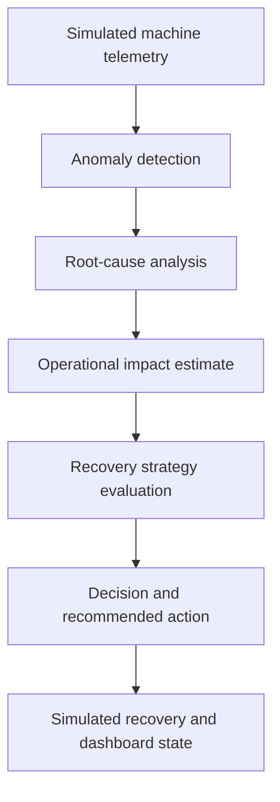

# CAUSEN AI — Industrial Incident Detection & Recovery Simulator

CAUSEN AI is a decision-support prototype for a simulated manufacturing line. It connects sensor telemetry, anomaly detection, root-cause analysis, impact estimation, and recovery-strategy comparison in one inspectable workflow.

**Scope:** the repository simulates industrial operations for engineering experimentation. It is not connected to real factory equipment and must not be used to control production machinery.

## What it demonstrates

- **Telemetry simulation:** generated readings for a connected, multi-machine production line.
- **Anomaly detection:** Isolation Forest scoring with sensor-channel attribution.
- **Root-cause analysis:** fault-mode classification from combinations of sensor signals.
- **Impact estimation:** modeled downtime, production loss, defect risk, and downstream delay.
- **Recovery planning:** what-if comparison of maintenance, speed derating, workload rerouting, and continuing without intervention.
- **Decision orchestration:** a multi-step backend pipeline that returns structured findings and a recommended action.
- **Interactive simulation API:** inject/reset faults, read simulated state, and execute recovery actions against simulator state.
- **Tests:** backend tests cover normal conditions, representative disruption scenarios, and deterministic results.

## Architecture



The simulation engine and its assumptions are documented in [simulation/README.md](simulation/README.md). API orchestration lives in `backend/ai_engine/`; the simulator bridge is `backend/simulator_bridge.py`.

## Technology

- **Backend:** Python, FastAPI, Pydantic
- **Analytics:** NumPy, Pandas, scikit-learn
- **Frontend:** React, TypeScript, Vite
- **Testing:** pytest
- **Integrations:** configurable approval/webhook workflows and a Vapi web client

## Repository map

| Path | Purpose |
|---|---|
| `backend/main.py` | FastAPI application and simulator endpoints |
| `backend/ai_engine/` | Anomaly, RCA, impact, recovery, and decision orchestration |
| `backend/simulator_bridge.py` | Connects API state and actions to the simulator |
| `backend/test_orchestrator.py` | Regression tests for representative scenarios |
| `simulation/src/` | Telemetry generation and simulation logic |
| `simulation/README.md` | Detailed simulation design, assumptions, and formulas |
| `frontend/` | React/Vite application |
| `simulator-ui/` | Additional Vite UI retained in the repository |

The repository currently contains both `frontend/` and `simulator-ui/`. Confirm the active deployment target before removing either; consolidating or clearly documenting the canonical UI is a useful maintenance task.

## Run locally

### 1. Start the API

From the repository root:

```bash
cd backend
python -m venv .venv
```

Activate the environment, then install dependencies and start the server:

```bash
# Windows PowerShell
.venv\Scripts\Activate.ps1

# macOS / Linux
source .venv/bin/activate

pip install -r requirements.txt
uvicorn main:app --reload --port 8001
```

API docs: [http://127.0.0.1:8001/docs](http://127.0.0.1:8001/docs)

### 2. Start the frontend

In a second terminal, from the repository root:

```bash
cd frontend
npm install
npm run dev
```

Point the frontend's configured API base URL at the local backend. The repository also includes a separate `simulator-ui/` Vite app.

### 3. Exercise the simulation API

| Method | Endpoint | Purpose |
|---|---|---|
| GET | `/api/state` | Read current simulator state |
| POST | `/api/fault/inject` | Inject a simulated fault |
| POST | `/api/fault/reset` | Reset the simulator |
| POST | `/api/recovery/execute` | Execute a recovery action in the simulator |
| POST | `/api/approval/pending` | Register a pending approval |
| POST | `/api/approval/resolve` | Resolve an approval workflow |

Interactive API docs are available at `/docs` while the backend is running.

## Configuration and security

- Keep private service credentials in an untracked backend `.env` file or deployment secret store.
- The `/api/vapi/token` endpoint returns a key to the browser. Configure **only a public client key** for that purpose; never return a private Vapi API key to the frontend.
- Workflow callback URLs and secrets must stay out of source control.
- Recovery execution affects only simulator state; it does not send commands to physical equipment.

## Current limitations

- Telemetry and recovery effects are simulated; the code is not physical PLC/SCADA control.
- Results depend on thresholds and assumptions encoded in the simulator. Validate against real data before drawing operational conclusions.
- The two Vite UI folders need a clearly documented canonical deployment target.
- GitHub Actions runs backend orchestration regression tests and builds the main frontend on pushes and pull requests.
